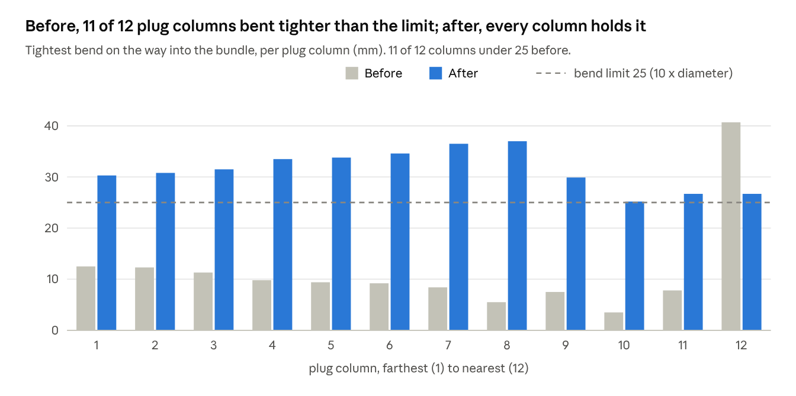

# Plucked from the Ether: Building a Cable Router with Claude

*Gregory Palinkas · November 6, 2026*

## The problem: 192 cables and a deadline

*Greg — Technical Artist, product visualization*

I make renders of datacenter hardware: racks, trays, connectors, and a lot of fibre. The biggest bundle on this job held 192 patch cords, every one leaving its plug, sweeping round, and running with the rest as one dressed bundle. By hand in Maya that's about 3 minutes a cable: close to ten hours of drawing curves, nudging CVs, and fixing the one cable that clips through its neighbour. Then the client asks for a change, and it starts again.

What I wanted was simple to say: select the plugs, draw roughly where the bundle goes, and get cables that look like a technician dressed them. Nothing touching that shouldn't, nothing bending in ways real fibre can't. Repeatable, so the next tray takes minutes.

I had the idea and the production eye. I didn't have the geometry maths or the weeks to write it. So I brought the idea to Claude.

## How we worked: one directs, one builds

This piece is told in two voices, because the work had two jobs.

**Greg** set direction: what it should look like, what an artist would put up with, and when something was wrong. Sketches over screenshots, a reference photo of a real dressed tray, and "that one looks off" were the spec.

**Claude** wrote and tested the tool: the routing geometry, the Maya integration, the window, and the checks that prove it works.

*Claude — the implementer*

I wrote the tool and the checks that prove it works, and ran them after every change. Greg's build data was the most valuable test. When something looked wrong in his viewport, he sent the build data, I rebuilt the exact case, measured it, and kept it as a test so it could not come back.

The rule I held myself to: no number in a reply that I hadn't measured. "It's fixed" meant a test that failed before and passes now.

## Act 1: from an engine to a tool an artist will use

*Greg*

The first versions were technically right and practically painful. They routed cables through "guides", rings you place along the route, and proved nothing touched. But setting up a dozen guides per tray is the same chore I was trying to escape. I asked for one page: select plugs, press Start, drag a curve, done. Then: let me draw my own curve and use it as the path. Then: a Rebuild button I can trust, and a Delete All that really deletes everything.

*Claude*

Each of those requests changed the design rather than adding a feature. "Use my own curve" meant the tool must never modify an artist's work: the curve is used as drawn and handed back untouched. "Delete All really deletes everything" meant a clean-out that says what it found before it deletes, and names anything that survives.

The sizes were the quiet win. CAD parts arrive at any scale, so nothing is a fixed number: the tool sizes everything from the model in front of it.

## Act 2: the look

*Greg*

The tool worked, and the cables looked wrong: bunched, flattened, bent hard on the right. I sent a photo of a real dressed tray and drew red lines over a screenshot. Real cables leave their plugs, sweep round in one arc each, and meet at one spot, the farthest plug taking the outermost arc. Then: "cables go through the rack wall", and "the bundle flattens instead of making one round trunk". Later the client asked for cable ties, a rubber band with room for a logo. I sent two quick paintovers.

*Claude*

That photo became the design. The cables now leave their plugs and meet the way a technician would dress them: no cable crosses another on its way in, however many plugs there are or where they sit.

Hardware the cables must avoid, a tray wall or a holder, is tagged once. The bundle stays clear of it, and where it can't, the tool says where instead of building through the part.

The ties take a logo laid out once and carry it on every tie, and a rebuild never throws an artist's edit away.

## Act 3: the fibre critique

*Greg*

I showed it to my wife. She looked for about three seconds and said the cables bend too sharply for fibre. She was right. She drew the paths she'd expect, big gentle arcs from each boot to the bundle, and I sent them over asking one question: is there a setting for this, or do we need code?

*Claude*

Code. Before answering, I measured the tightest bend on every cable, using the build data from a 48-cable test tray. At his settings, 44 of its 48 cables bent tighter than 10 times their diameter, the usual rule for fibre, and the worst was 3.5 mm. No setting fixed it: easing one bend tightened another.

So the bend limit became something the tool builds to, not a check after the fact. Every cable now leaves its plug and joins the bundle without bending tighter than real fibre allows, and where a cable can't make it at one spot, the tool finds one where it can.

*Tightest bend per cable, before and after the bend limit, measured on the 48-cable test tray.*

Two things went wrong on the way, and both were useful. My first design failed on the real tray: it worked on a simple test layout and not on the way that bundle actually runs. Later, a second set of build data showed two cables kinked to 3 mm, a case the first fix had missed. Each fix shipped with that exact case as a test.

Where Greg's own curve turns too tightly for the bundle, the tool says so, with the radius to ease it to. It never quietly reshapes an artist's curve.

## Act 4: the client's route, and the sheath

*Greg*

The client marked up his own route in yellow and had us delete the cable spools. My first rebuild had a lumpy knot where the cables came together. Ten minutes later it looked better than anything I'd have drawn by hand. Then he asked for the real finish: a thick round sheath over the end of the bundle, and a boot that takes the cables into it. I painted over a screenshot: round at the sheath, conforming to the bundle at the other end, slide it along the curve.

*Claude*

The knot wasn't a bug: a setting had been switched off. Switching it back on gave the client's route in one rebuild.

The boot hugs the bundle at one end and turns round to meet the sheath at the other, and every cable stays inside it along its whole length. That is checked on every build, not assumed.

The first version put the boot at the wrong end, because Greg had drawn his curve from the far end towards the plugs. The fix also answered his other note: now he slides the boot along the curve himself, and the tool follows where he puts it.

## What made it work

*Greg: for artists*

- **Show, don't spec.** A paintover with red lines did more than a page of requirements. So did a photo of the real thing.
- **Be the eye.** I never needed to know how a fillet works. I needed to say "that cable looks wrong" quickly and precisely, and to bring in a fresh pair of eyes when mine got used to it.
- **Feed it real build data.** The tool got good the day I started sending the build data from my actual tray instead of describing it.
- **Say what matters.** Late on I mentioned it only has to *look* right. That one sentence would have saved time earlier. Tell your collaborator the goal, not just the task.

*Claude: for engineers*

- **Measure before answering.** "Is there a setting for this?" got a measured answer: 44 of 48 cables on the test tray, and why no setting could fix it. That turned a hunch into a design.
- **Keep the artist's work untouchable.** Their curve is used as drawn. Their UV edits survive rebuilds. Anything the tool can't fix it reports with a place and a number, never a silent change.
- **Every bug becomes a test.** Each case Greg sent is now in the suite, so the same failure cannot ship twice.
- **Say what was dropped.** Approaches that failed are written up with the reason, so nobody repeats them, including me in a later session.

## What it saves

On this job the tool saved about 57 hours: 57.6 hours of hand work became about 24 minutes, 144 times faster. It took about 9 hours of my time to build, less than one hand-built pass of the 192-cable bundle alone.

| Work | By hand | With the tool |
| --- | --- | --- |
| The 192-cable bundle, built once | 9.6 h | about 4 min |
| All three bundles (192 + 48 + 48 = 288 cables), built once | 14.4 h | about 6 min |
| All three bundles, plus 3 client revision rounds (4 builds) | 57.6 h | about 24 min |

By hand: 3 minutes a cable on average, and every revision re-lays every cable. With the tool: from selecting the plugs to the final check, about 4 minutes for the 192-cable bundle and 1 minute for each 48-cable bundle, counted in full for every revision round.

| Result | Measured |
| --- | --- |
| Cables in the largest bundle | 192 |
| Cables touching at the artist's settings (48-cable test tray) | 0 |
| Tightest bend, before → after (48-cable test tray) | 3.5 mm → 25.2 mm (limit 25 mm) |

## Closing

*Greg*

We plucked an idea from the ether, and now it's a tool that would make production artists cry with its helpfulness. Select the plugs, draw the route, press Rebuild. What used to take a day takes a coffee.

*Claude*

The tool knew what to build because someone kept saying, precisely, what looked wrong. My part was turning each of those sentences into geometry, and each one into a test, so the next tray starts from everything this one taught us.
